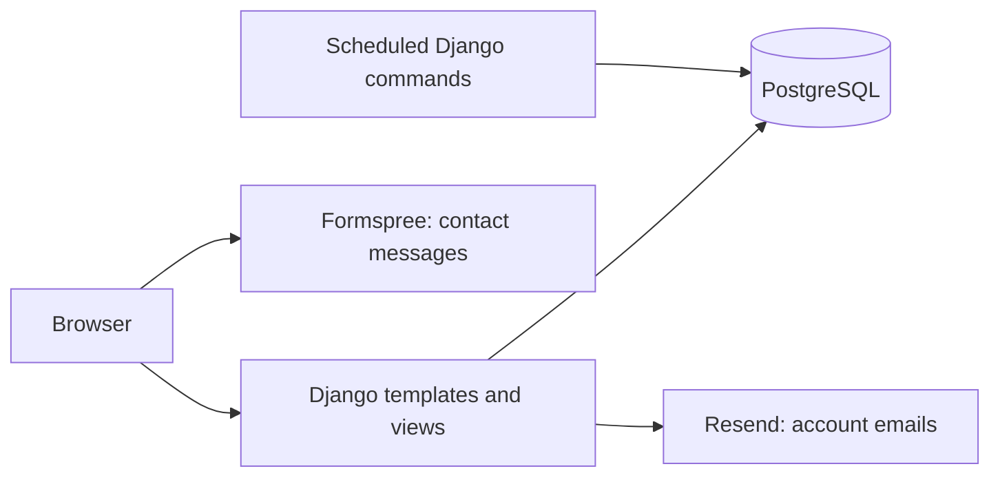

# Tabula Belli

**Discover, organize, and join tabletop gaming events across Europe.**

Tabula Belli is a full-stack Django application for wargames, tabletop RPGs, and trading card games. Players can find events by game and location, reserve a place, and manage the events they organize or attend.

Originally developed as an academic project, it has been extended into a deployed portfolio application, with tested account flows, PostgreSQL-backed tests, reproducible demo data, and automated maintenance.

> **Portfolio demonstration:** The included events, players, and registrations are fictional and intended for testing. They do not represent real activities. Visitors can also create test accounts and content.

**[Try the live application](https://tabula-belli.n3t0n.com/)** · [User guide](docs/user-guide.md) · [Installation guide](docs/installation.md)

## Try it

Browse events without an account, use the shared demo account, or create your own account with email verification.

| Demo username | Demo password |
| --- | --- |
| `horus_lupercal` | `TestPass123!` |

Select **Fill demo credentials** on the login page, then **Sign in**.

The demo is interactive: you can create and edit your own events, join other events, and cancel registrations. Its profile, email, password, and account deletion are protected so the shared account remains available to other visitors. Everyone using the demo shares the same identity and activity.

The published application contains synthetic data alongside accounts and content created by visitors. It is a portfolio demonstration, not a service for arranging real events. Every two months, the dataset is rebuilt and visitor accounts, events, and registrations are removed. Event organizers can access participant email addresses, and an event's organizer contact address is visible on its detail page. Creating your own account requires an email address you can access to complete verification.

## What you can do

- **Discover events:** search, filter by game and location, sort results, and navigate paginated listings.
- **Join events:** register within the registration window and capacity limits, or cancel your place.
- **Organize events:** create, edit, and cancel events, and manage their participants.
- **Track your activity:** use My Events to find events you organize or attend.
- **Manage your account:** verify your email, update your profile, change account details, and recover your password.
- **Delete your account:** review the consequences before confirming; future commitments are canceled while past event history retains a Deleted account label. An organized event in progress must finish before deletion.

The interface includes light and dark themes. HTMX updates listings and event actions without requiring a separate frontend application.

## Technology

| Area | Technologies |
| --- | --- |
| Backend | Python 3.12, Django 5.2, django-allauth |
| Database | PostgreSQL 17 |
| Frontend | Django templates, HTMX, Alpine.js, Tailwind CSS, Flowbite |
| Static files and application server | WhiteNoise, Gunicorn |
| Transactional email | Resend through django-anymail |
| Contact messages | Formspree |
| Location catalogue | django-cities-light and a versioned GeoNames extract |
| Deployment | Northflank, with DNS managed through Cloudflare |
| Continuous integration | GitHub Actions |

Python dependencies are pinned in `requirements.txt`; frontend dependencies are resolved in `package-lock.json`. Supported Python and Node versions are recorded in `.python-version` and `.node-version`.

## Architecture and decisions

The application is a Django monolith with server-rendered pages. Domain apps separate accounts, players, games, events, locations, and general pages. PostgreSQL stores both application data and the location catalogue.



- **Server-rendered interaction:** HTMX requests reuse Django views and templates; Alpine.js handles local UI behavior. The frontend is served by the same Django application.
- **Consistent event changes:** authorization policies, database transactions, constraints, and concurrency tests support event management and registration capacity rules.
- **Account lifecycle:** django-allauth supplies verification and recovery flows. Application-specific rules protect the shared demo identity and define account deletion behavior.
- **Reproducible reference data:** a fixed location fixture avoids downloading a changing external catalogue during installation. Demo events use dates relative to the seed execution date.
- **Automated maintenance:** scheduled commands complete past events and rebuild disposable demo data. PostgreSQL locks coordinate resets with application activity; visitors see a temporary maintenance page during the reset.

## Run locally

Follow the [Installation guide](docs/installation.md) to create a local PostgreSQL database, configure `.env`, install dependencies, build frontend assets, apply migrations, and load the catalogue and demo seeds.

Local evaluation does **not** require Northflank, Cloudflare, Resend, or Formspree accounts. Verification and password recovery emails are printed in the development terminal. The contact form remains disabled unless a Formspree endpoint is configured.

PostgreSQL is required; SQLite is not a supported installation target. Create your own local administrator with Django's `createsuperuser` command if you want to inspect the admin interface.

## Tests and CI

With the local environment and PostgreSQL configured, run from the repository root:

```sh
DEBUG=False python src/manage.py test
python src/manage.py check
python src/manage.py makemigrations --check --dry-run
npm run build
node --test scripts/tests/*.test.cjs
```

The installation guide covers test database permissions, configuration and the equivalent PowerShell command.

The test suite covers account flows, authorization, event lifecycle rules, registrations, demo restrictions, account deletion, and concurrent maintenance behavior.

GitHub Actions checks dependencies and vulnerabilities, runs tests against PostgreSQL, verifies migrations, builds frontend assets, collects static files, and runs production configuration checks. See [the CI workflow](.github/workflows/ci.yml).

## Published deployment

The live application runs on Northflank with PostgreSQL, Gunicorn, and WhiteNoise. Cloudflare manages the domain's DNS; Resend delivers account verification and password recovery emails.

Two scheduled Django commands provide maintenance:

- `complete_past_events`: every five minutes, marks ended active events as completed.
- `reset_demo`: every two months, rebuilds the disposable dataset with fresh relative dates. A temporary maintenance page is shown while the reset runs.

The Contact page sends messages through Formspree, independently of the account emails delivered by Resend.

The installation guide targets local development. Hosting your own instance requires your own production configuration, email/contact services where needed, and scheduling of the maintenance commands.

## Repository layout

```text
tabula-belli/
├── .github/workflows/ci.yml
├── docs/
│   ├── installation.md
│   └── user-guide.md
├── fixtures/
│   ├── locations/
│   └── ...                    # Game data and event templates
├── scripts/                   # Frontend dependency copying
├── src/
│   ├── apps/                  # Domain models, views, services and tests
│   ├── config/                # Settings, URLs and maintenance coordination
│   ├── static/                # Frontend source files and generated assets
│   └── templates/             # Shared layouts and account templates
├── .env.example
├── package.json
├── package-lock.json
├── requirements.in
└── requirements.txt
```

## Demo data and sources

The initial dataset combines real reference information with fictional activity:

- **Locations:** real European countries, administrative regions, and cities from [GeoNames](https://www.geonames.org/), under CC BY 4.0. See [catalogue provenance](fixtures/locations/README.md).
- **Games:** real wargames, tabletop RPGs, and trading card games listed in the project's seed catalogues.
- **Events and registrations:** synthetic records created for demonstration; they do not represent real scheduled activities or bookings.
- **Players and organizers:** fictional demo profiles inspired by the Primarchs from Warhammer's Horus Heresy setting.

On the published application, these initial records can coexist with test accounts, events, and registrations created by visitors. The periodic reset replaces this activity with a fresh demo dataset.
